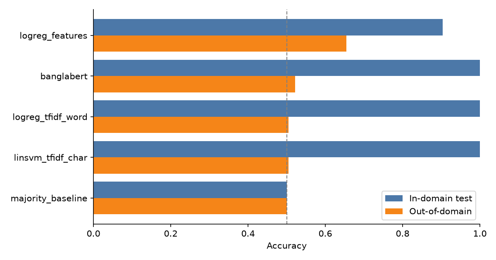

# Bangla Source Detector

**Was this Bangla text written by an LLM, or machine-translated from English?**

A fine-tuned [BanglaBERT](https://huggingface.co/csebuetnlp/banglabert) classifier that tells LLM-generated
(synthetic) Bangla from Google-translated Bangla. It's benchmarked against the classical models from my
CSE437 research paper, both in-domain and on **out-of-domain text it never saw**.

[](https://github.com/MehediHasan19131/bangla-source-detector/actions/workflows/ci.yml)
[](https://colab.research.google.com/github/MehediHasan19131/bangla-source-detector/blob/main/notebooks/train_colab.ipynb)

## Why this matters

Low-resource languages like Bangla get LLM training data from two places: text **generated** directly by an LLM,
and English text **machine-translated** into Bangla. Corpora usually mix the two without checking. That's a
data-quality problem: translated text carries English sentence structure ("translationese"), and training on
too much model-generated text can cause *model collapse*. A detector lets you audit where a corpus came from.

In our paper (*Distinguishing LLM-Generated Synthetic Bangla from Machine-Translated Bangla*, BRAC University),
classical models scored up to 100% in-domain but **fell to ~50% (chance) on text from other sources**. The best
out-of-domain model reached only 69%. The paper's future work asked whether a fine-tuned Bangla transformer would
generalize better. This repo answers that question.

## Results

40,000 training stories, 5,000 test stories (balanced), and 7,160 out-of-domain texts that no model sees during
training. BanglaBERT was fine-tuned for 1 epoch on 16,000 stories on an Apple M4 (40 min, MPS).



| Model | In-domain acc | Out-of-domain acc | OOD ROC-AUC | OOD synthetic recall | OOD acc, 10 labels/class | OOD acc, 100 labels/class |
|---|---|---|---|---|---|---|
| **BanglaBERT (fine-tuned)** | **1.000** | 0.522 | **0.788** | 0.046 | **0.701** | **0.725** |
| LogReg, 15 engineered features | 0.904 | **0.655** | 0.702 | 0.682 | 0.651 | 0.672 |
| Linear SVM, TF-IDF char 3–5 | 1.000 | 0.504 | 0.731 | 0.010 | 0.651 | 0.668 |
| LogReg, TF-IDF word 1–2 | 1.000 | 0.505 | 0.663 | 0.010 | 0.596 | 0.609 |
| Majority class | 0.500 | 0.500 | – | – | – | – |

Full tables: [results/RESULTS.md](results/RESULTS.md) · [results/CALIBRATION.md](results/CALIBRATION.md)

### What the numbers say

1. **The paper reproduces.** On fresh samples, the classical models land where the paper reported them
   (feature LogReg 0.904 vs 0.903 in-domain; TF-IDF models 1.000 in-domain, ~0.50 out-of-domain).
2. **Fine-tuning alone does not fix generalization.** BanglaBERT is near-perfect in-domain (1 error in 5,000).
   Out-of-domain it falls to 0.522, labelling 95% of LLM-generated texts as "translated". This is the same
   collapse the TF-IDF models show.
3. **The model still learns something that transfers, but its threshold doesn't.** BanglaBERT has the best
   out-of-domain ROC-AUC (0.788): it still *ranks* texts reasonably well, but on new data every score lands on the
   "translated" side of 0.5.
4. **A few labels fix most of it.** If an auditor hand-labels just **10 texts per class** from the new source and
   re-picks the threshold, BanglaBERT reaches **0.701** (mean of 50 random draws; those 20 texts are excluded from
   scoring). At 100 per class it reaches **0.725**, the best of all models and above the paper's best (0.691).

In practice, a source detector trained on one corpus should come with a small labelled calibration set for each
new corpus it's used on. A near-perfect in-domain score says very little on its own.

## How it works

```
Regional-TinyStories (HF, 2 × ~4.5 GB JSON)          Bangla-Instruct + alpaca-bengali (HF)
        │  random 1 MB byte-range sampling                     │
        ▼                                                      ▼
  clean: NFC, ≥70% Bangla script, dedupe, length bounds  (same rules for every source)
        │                                                      │
  balanced 80/10/10 split (stratified)                 out-of-domain test set (never trained on)
        │
        ├── baselines.py   15 engineered features + LogReg, TF-IDF word LogReg, TF-IDF char SVM
        └── train.py       BanglaBERT fine-tuning (HF Trainer, best checkpoint by val F1)
                                    │
                         metrics.py: same metrics for every model → report.py → RESULTS.md + chart
                                    └─ per-row scores → calibrate.py (few-shot OOD threshold)
```

- **Data without the 9 GB download.** The source files are single giant JSON arrays, so `bsd.data` reads random
  1 MB byte ranges over HTTP and parses only the complete records in each window. The result is a uniform sample
  for a few hundred MB of traffic.
- **Fair comparison.** Baselines and the transformer use identical splits and one shared `metrics.compute`.
  Hyperparameters are tuned on the validation split only, so the test and out-of-domain sets stay untouched.
- **Per-class recall is reported**, because the paper's failure mode was a model predicting "translated" for
  almost everything. Plain recall hides that.
- **Labels:** `0 = synthetic` (GPT-4o-mini), `1 = translated` (Google Translate).

## Quick start

```bash
python -m venv .venv && source .venv/bin/activate
pip install -e ".[train,app,dev]"

python -m bsd.data --per-class 25000       # build data/ (train, val, test, ood)
python -m bsd.baselines                    # classical models → results/baselines.json
python -m bsd.train                        # fine-tune BanglaBERT → models/banglabert, results/banglabert.json
python -m bsd.calibrate                    # few-shot OOD threshold calibration → results/CALIBRATION.md
python -m bsd.report                       # results/RESULTS.md + results/accuracy.png
python app.py                              # Gradio demo at http://127.0.0.1:7860
```

No GPU? Use the **Colab notebook** (free T4 GPU). Apple Silicon works through
PyTorch's MPS backend. Add `--train-limit 2000` for a quick run.

Other options: `--model xlm-roberta-base` to compare a multilingual model, `--report-to wandb` to track runs,
`--push-to-hub user/repo` to publish the model.

## Project layout

```
src/bsd/
  clean.py      normalization + filters shared by every source
  data.py       byte-range sampler, OOD loaders, stratified splits
  features.py   the paper's 15 interpretable features
  baselines.py  classical models from the paper
  train.py      transformer fine-tuning
  metrics.py    one scoring function for every model (+ saves per-row scores)
  calibrate.py  few-shot threshold calibration on out-of-domain data
  predict.py    Detector class + CLI
  report.py     comparison table and chart
app.py          Gradio demo (prediction + interpretable features)
tests/          unit tests for cleaning, features, metrics, parsing (run in GitHub Actions)
```

## Limitations

- The out-of-domain set changes **two things at once**: the text sources *and* the genre (instructions/answers
  instead of children's stories). A drop there mixes both effects.
- There is only one generator (GPT-4o-mini) and one translator (Google Translate), so the model may learn their
  style rather than "synthetic vs translated" in general.
- Inputs are truncated to 256 tokens. That also limits how much the model can lean on story length, which the
  paper found to be a corpus artifact.
- BanglaBERT's authors recommend their [normalizer](https://github.com/csebuetnlp/normalizer); this repo uses
  Unicode NFC + whitespace cleanup instead.

## Next steps

- Train for longer on all 40k stories (Colab notebook) and compare `xlm-roberta-base`.
- Train on several generators and translators (future work from the paper) and test on held-out ones.
- Use the calibrated scores to estimate *what share* of a mixed corpus is synthetic.
- Add attribution (e.g. integrated gradients) to compare what BanglaBERT attends to against the paper's features.

## Citation

Md. Shakibul Islam, Mehedi Hasan, Junaed Ahmed, Md. Sabbir Ahmed, Md. Golam Robiul Alam.
*Distinguishing LLM-Generated Synthetic Bangla from Machine-Translated Bangla: A Classification Study Using the
Regional-TinyStories Corpus.* BRAC University.

Data: [Regional-TinyStories](https://huggingface.co/TinyStories-Regional) ·
[Bangla-Instruct](https://huggingface.co/datasets/md-nishat-008/Bangla-Instruct) ·
[alpaca-bengali-cleaned](https://huggingface.co/datasets/saillab/alpaca-bengali-cleaned)

## License

MIT for the code. Datasets and BanglaBERT keep their own licenses.
